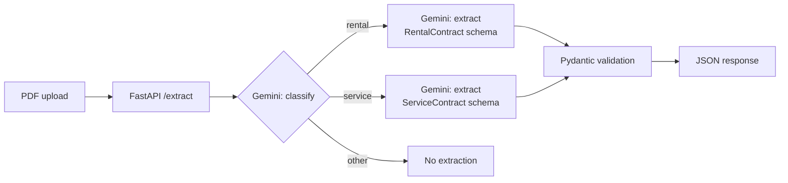

# Contract Extractor

API that reads Brazilian **rental** and **service** contracts (PDF) and returns their key fields as validated JSON, using **Gemini** structured output, plus an **evaluation harness** that measures field-level accuracy on a labeled synthetic dataset.

```
POST /extract  (contrato.pdf)
→ { "contract_type": "rental",
    "data": { "tenant": {"name": "...", "document": "..."}, "monthly_rent": 2350.0,
              "start_date": "2025-03-15", "guarantee_type": "deposit", ... },
    "model": "gemini-3.8-flash", "latency_ms": 3120 }
```

## How it works



- The PDF is sent **natively** to Gemini (no OCR or text-extraction step), so layout and tables are preserved.
- **Pydantic models are the single source of truth**: the same classes become the Gemini response schema, validate the output and define the OpenAPI contract.
- `temperature=0` and low thinking level for deterministic, cheap extraction.

## Evaluation

The dataset in [`data/`](data) has **34 synthetic contracts** (15 rental, 15 service, 4 out-of-scope documents) generated with Faker `pt_BR`. All people, companies and documents are fake. Each type uses two templates with different wording (numeric vs. written-out dates, values in digits and in words, different clause order), so it is not a single-template problem.

Each field has an explicit scoring rule ([`eval/metrics.py`](eval/metrics.py)):

| Field kind | Rule |
|---|---|
| CPF / CNPJ | digits match |
| Amounts | within R$ 0,01 |
| Dates, enums, integers | exact match |
| Names, city | match ignoring case and accents |
| Address | ≥ 90% string similarity |
| Free-text summaries (scope, payment terms) | must mention the key terms |

A misclassified document counts as wrong on every field.

<!-- Paste the summary from eval/results.md here after running `make eval` -->
**Results:** see [`eval/results.md`](eval/results.md).

## Design decisions

- **Two calls instead of one.** A single "union" schema would force the model to choose between optional sub-objects and makes validation loose. Classifying first keeps each extraction schema small and strict, and skips the expensive call for unsupported documents. Trade-off: one extra (cheap) request per document.
- **Native PDF over text extraction.** Avoids a brittle OCR/parsing layer; the model sees the document as the user does.
- **Rules per field in the evaluation.** "Correct" means different things for a CPF and for a summary, so a single string-match metric would be misleading.
- **Synthetic data.** Real contracts contain personal data; generated contracts with known ground truth make the evaluation reproducible and shareable.

## Running locally

```bash
python -m venv .venv && source .venv/bin/activate
make install
cp .env.example .env          # add your GOOGLE_API_KEY (free at aistudio.google.com)

make test                      # unit tests, no API key needed
make run                       # http://localhost:8080/docs
make eval                      # runs the evaluation against Gemini
```

Try it:

```bash
curl -F "file=@data/contracts/rental_001.pdf;type=application/pdf" http://localhost:8080/extract
```

Docker:

```bash
make docker
```

Vertex AI is also supported: set `GOOGLE_GENAI_USE_VERTEXAI=true`, `GOOGLE_CLOUD_PROJECT` and `GOOGLE_CLOUD_LOCATION` instead of the API key.

## Project structure

```
app/
  main.py        FastAPI app and upload validation
  extractor.py   two-step Gemini pipeline
  schemas.py     Pydantic models (response schema + API contract)
  prompts.py     extraction rules
data/
  generate.py    synthetic contract generator (PDF + labels)
  contracts/     generated PDFs
eval/
  metrics.py     per-field scoring rules
  run_eval.py    runs the dataset and writes results.md
tests/           API, pipeline and metric tests (Gemini mocked)
```

## Stack

Python 3.13 · FastAPI · Pydantic · Google Gen AI SDK (Gemini) · pytest · Docker
